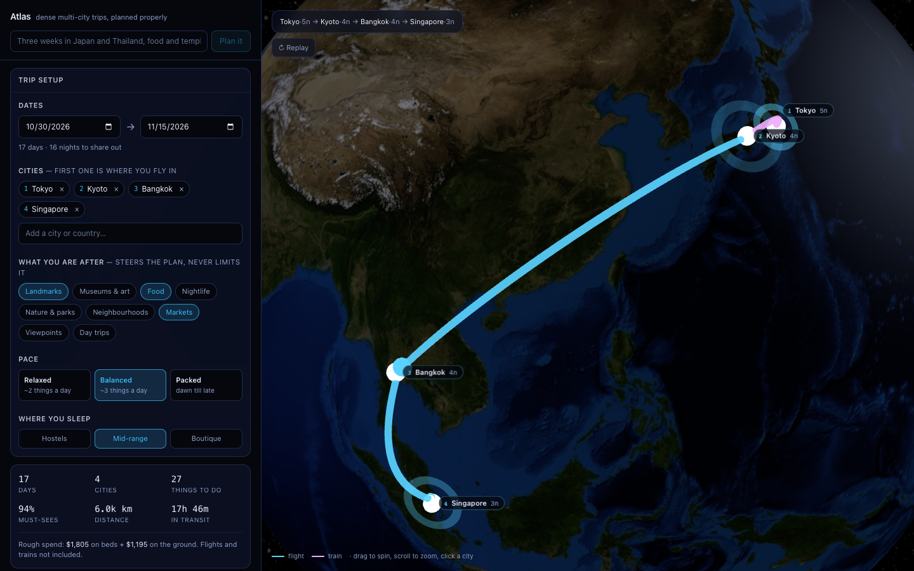

# Atlas

A trip planner for **dense multi-city travel** — the kind where you have 17 days
and four cities and want the most out of every one of them, not a shallow
sample of each.

Ask for a trip in plain English (or fill in the form), and Atlas works out the
route, splits the nights between cities, fills each day morning-to-evening, and
suggests where to sleep — then draws the whole thing on a globe, arc by arc.



## Running it

```bash
npm install
npm run dev          # http://localhost:3000
```

The app is fully usable with no API key — free-text requests fall back to a
keyword parser, and the city catalogue (below) is limited to the 23 seeded
cities. To have Claude interpret requests properly and look up any city in
the world:

```bash
echo 'ANTHROPIC_API_KEY=sk-ant-...' >> .env.local
```

The key needs to be scoped to a specific workspace (Console → Settings →
API Keys → pick a workspace, Default is fine) — an org-level key with no
workspace attached gets rejected with `anthropic-workspace-id` errors.

For the city cache, nothing else is required locally — it falls back to a
`.cache/` folder on disk automatically. **Before deploying**, see
"Deploying" below; the file cache does not survive a serverless deploy.

Other scripts:

```bash
npm run build        # production build
npm run typecheck    # tsc --noEmit
npm run lint
npx tsx scripts/plan-smoke.ts   # print full itineraries as text, no browser
```

## How the planner thinks

Four stages, all pure functions in `src/lib`, all runnable in the browser —
which is why adjusting a plan is instant and needs no server round trip.

| Stage | File | What it decides |
|---|---|---|
| Route | `route.ts` | City order, by geography rather than click order. Nearest-neighbour then 2-opt on an *open* path (multi-city trips are usually open-jaw), anchored at the city you fly into. |
| Nights | `allocate.ts` | How to split the nights, by each city's **demand** — the interest-weighted hours of things to do there. A nine-must-see city outranks a three-must-see one instead of splitting the trip evenly. |
| Days | `pack.ts` | What you do each morning, afternoon and evening. |
| Everything else | `itinerary.ts` | The calendar, lodging ranking, warnings, totals. |

Two rules in the packer do most of the work:

- **Neighbourhood gravity.** Once a day has its first activity, anything in the
  same neighbourhood gets a large scoring bonus. Days cluster geographically on
  their own, with no hand-written zone plan — this is the single biggest lever
  on how much you actually see in a day.
- **Slot fitness.** Nightlife only lands in the evening, markets in the morning.
  The data says where something belongs and the packer obeys it.

Some deliberate choices worth knowing:

- **Interests steer, they never filter.** Tick only "food" and you still get the
  Colosseum, and you still get full days rather than empty ones — off-interest
  activities just rank lower.
- **Travel is costed honestly.** A hop eats the morning of the day you move
  (both halves if it is six hours or more), and that time is shown as lost, not
  hidden. Rail is only offered where it is genuinely competitive.
- **Opening days are modelled.** A weekend-only market booked on a Friday, or a
  Monday in Florence with the Uffizi and the Accademia both shut, is a wasted
  day. The packer respects closures and warns when a must-see is closed every
  day you are in town.
- **Lodging is ranked against your actual days.** Staying in the district where
  your activities are beats a nicer room across town, because it converts
  commute time into sightseeing time.
- **The warnings are the opinion.** "2 nights in Berlin is thin", "you are
  averaging 1.4 nights per city, cutting a stop would buy real time in the
  rest", "that is a 9h door-to-door day". The planner tells you when your trip
  is over-ambitious rather than quietly producing a bad one.

## The globe

`src/components/Globe.tsx` — three.js, written directly rather than via a globe
library, because the sequential draw-the-route animation is the point.

- Arcs follow true great circles, lifted in a sine profile whose peak scales
  with distance, so a Rome–Florence train hugs the surface and a Tokyo–Bangkok
  flight bows clear of it.
- Arcs draw themselves by advancing `setDrawRange` over a `TubeGeometry`'s index
  buffer, snapped to whole rings so the tip stays clean.
- The camera leads each arc as it draws, then pulls back to frame the whole
  route.
- Labels are positioned by direct DOM writes each frame — never React state — and
  do rectangle-collision avoidance with three fallback placements, so cities as
  close as Tokyo and Kyoto both keep their labels.
- Colour marks the mode: cyan for flights, pink for trains.

## The adventure map

`src/components/AdventureMap.tsx` — a second view, toggled alongside the
globe: a sepia parchment map with a dotted red line and a plane icon tracing
each hop, in the Indiana-Jones-travel-montage style.

The land is real Natural Earth 110m coastline data (via `world-atlas`), not a
decorative image — `scripts/build-worldmap.mjs` projects it equirectangular
and bakes the result to a static SVG path (`src/lib/worldmap-data.ts`) ahead
of time, along with the exact projection formula used to produce it. That
means the browser ships one path string and some arithmetic rather than
`d3-geo`/`topojson-client` (both stay devDependencies), and city markers are
guaranteed to land in the right place because the component projects lon/lat
with that same baked formula.

The map zooms to the route's own bounding box instead of always showing the
whole planet — since everything lives in one baked coordinate space, "zoom"
is just picking a smaller `viewBox`, and dot size, stroke widths, marker
radii, and label text all scale correctly for free as SVG user-space units.
The dotted line itself is sampled at even arc-length spacing along a bowed
curve (not evenly in `t`, which would bunch dots on the bend) and reveals
dot-by-dot on the same draw-the-route pacing as the globe.

Known limitation: a flat map can't show the literal shortest path the way the
3D globe's great-circle arcs can, so a hop that spans roughly half the globe
(say, Tokyo to a US city) draws a straight line across whichever side of the
map is visible rather than wrapping the antimeridian — a cosmetic tradeoff of
the genre (the films' own maps never show that kind of route either).

## Any city, not just the catalogue

The 23 seeded cities (`src/lib/cities.ts`) are a hand-curated quality floor,
not a hard limit. Any real city can be added — through "🔍 Search online" in
the trip-setup form when the local list comes up empty, or by just naming it
in a free-text request ("a week in Hoi An"). Nothing downstream needs to
know the difference: `route.ts`, `allocate.ts`, `pack.ts` and `itinerary.ts`
only ever call `getCity`/`getActivities`/`getLodging` — never the static
`CITIES` array directly — so a resolved city behaves identically to a
curated one everywhere, including the globe and the adventure map.

**Resolution, cheapest check first** (`src/lib/resolveCity.ts`):

1. Already known this session (static seed, or resolved earlier) — free.
2. In the persistent cache — free, shared across every user who's ever
   asked for this city before.
3. Neither — geocode via OpenStreetMap's Nominatim (free, no key; also
   doubles as validation — a name that doesn't geocode to anywhere real
   gets rejected rather than silently built into a trip), then generate via
   two Claude calls: one researches the city with live web search
   (`src/lib/generateCity.ts`), the second structures that research into the
   same City/Activity/Lodging shape the hand-written rows use. The result is
   written through to the cache and merged into the live registry.

**This is genuinely slow — by design, not by bug.** A cache miss means two
sequential Claude calls, one of them doing real web research: measured at
60–110 seconds depending on the city. That's the cost of it being *actually*
researched rather than guessed from training data. It only happens once per
city, ever — every request after, from anyone, is a cache hit in well under
a second. The UI says this plainly rather than pretending to be fast.

**The cache backend** auto-selects based on what's configured
(`src/lib/cache.ts`), same "upgrade automatically when credentials exist"
pattern as the Claude key:

- No `UPSTASH_REDIS_REST_URL`/`UPSTASH_REDIS_REST_TOKEN` → a `.cache/`
  folder on disk. Zero setup, correct for local dev, **does not survive a
  serverless deploy** (fresh instance, empty disk).
- Both set → [Upstash Redis](https://upstash.com) — a free-tier, REST-based
  store that works the same from a serverless function as a long-running
  server, no platform lock-in (it's just HTTPS calls, works behind any host).

## Deploying

Two things that are easy to miss, both because the city-generation path is
slow by nature (see above):

1. **Set up Upstash before you deploy**, or every cold start starts the
   cache over from empty. Create a free database at
   [upstash.com](https://upstash.com), copy its REST URL and token into your
   host's environment variables alongside `ANTHROPIC_API_KEY`, and the app
   switches to it automatically — no code change.
2. **Raise the function timeout** on `/api/city` and `/api/plan` — both
   already set `export const maxDuration = 180` in their route files, but
   the actual ceiling your platform honours depends on your plan (e.g.
   Vercel's Hobby tier caps well below 180s regardless of what the route
   requests; Pro/Fluid Compute allows much longer). Check this specifically
   once deployed — a city generation that gets killed mid-request by the
   platform's own timeout is the one way this app could still fail to
   service a city.

## Layout

```
src/
  app/
    api/plan/     free-text trip requests (Claude + any-city resolution)
    api/city/     resolve one city by name (used by TripForm's search-online)
  components/     Globe, AdventureMap, TripForm, ItineraryList
  lib/
    types.ts            domain model
    cities.ts            seed data (23 cities) + the live, mutable registry
    geo.ts                haversine, great-circle interpolation, hop modes
    route.ts              city ordering
    allocate.ts           night allocation
    pack.ts               day packing
    itinerary.ts          orchestration, lodging ranking, warnings
    llm.ts                Claude (structured outputs) + keyword fallback
    resolveCity.ts         any-city resolution: registry → cache → generate
    generateCity.ts         the Claude research → structure pipeline
    geocode.ts              free Nominatim geocoding, no key
    cache.ts                Upstash/file cache, auto-selected
    dates.ts              ISO date helpers
    worldmap-data.ts      generated — baked land path + projection (do not edit)
scripts/
  plan-smoke.ts         text-mode itinerary printer
  build-worldmap.mjs    regenerates worldmap-data.ts from world-atlas
```

## Known gaps

- Data is hand-curated for the 23 seed cities, Claude-generated-and-cached
  for everything else — neither is live. No real prices, availability or
  booking, for either kind of city.
- Lodging suggestions are static picks, not search results.
- No manual reordering of cities; the route is always geography-optimised.
- Hop durations are modelled, not looked up from real timetables.
- A city name that's genuinely ambiguous without a country ("Springfield",
  "San Jose") may resolve to the wrong place — pass the country to
  disambiguate (the UI prompts for this).
- No retry on a failed generation (web search comes up empty, or the
  structuring call doesn't parse) — it surfaces as an error rather than
  silently falling back to something worse; trying again usually works.
- Generated cities aren't reviewed by a person before being cached and
  served to the next user who asks — worth knowing before pointing this at
  real traffic.
